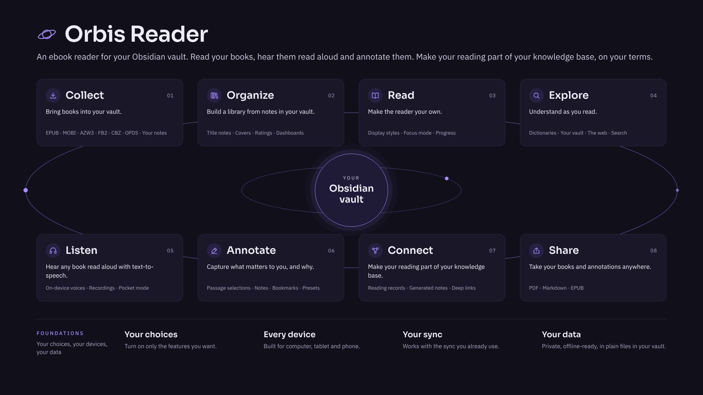
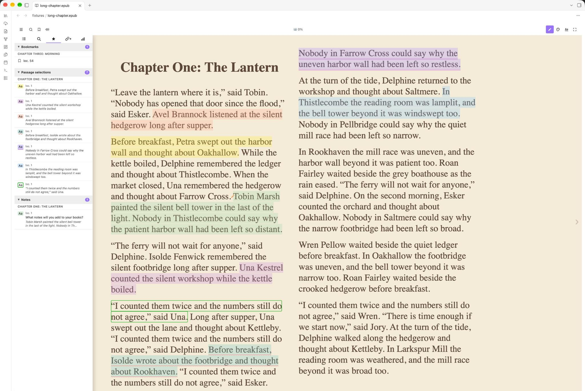
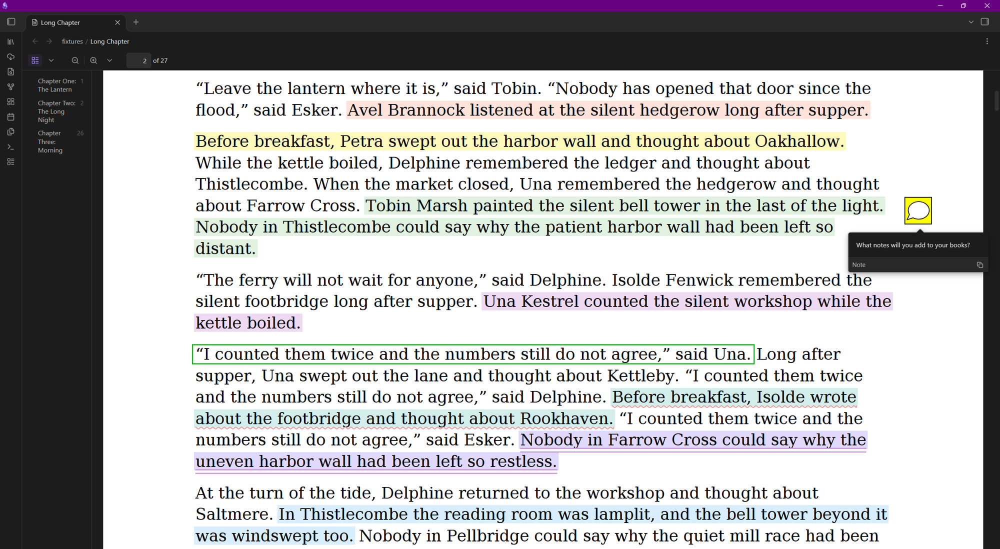
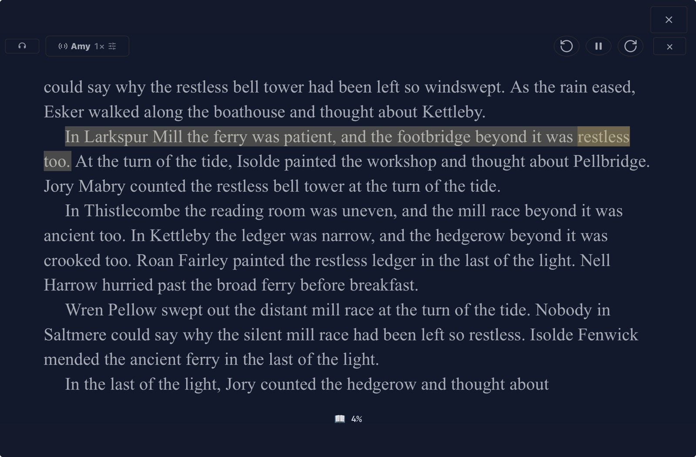
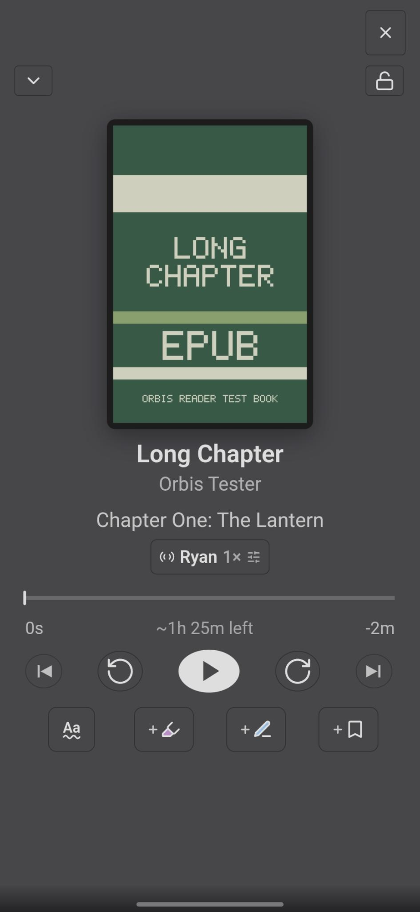
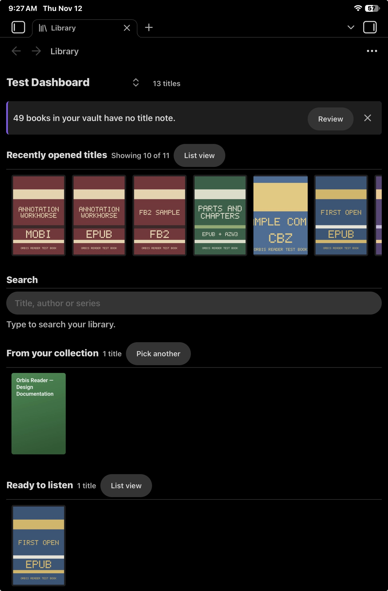
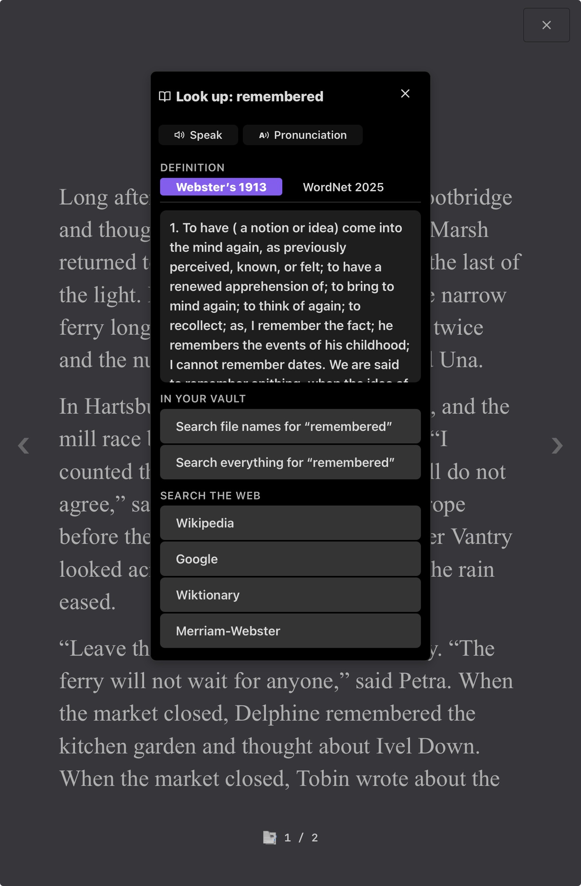

# Orbis Reader

An ebook reader for your [Obsidian](https://obsidian.md) vault. Read your books, hear them read aloud and annotate them. Make your reading part of your knowledge base, on your terms.

---

## Features

### Collect: bring books into your vault

- Open the EPUB, MOBI, AZW3, FB2 and CBZ files you already have.
- Browse, search and download books from Project Gutenberg (built in), your own Calibre server and other OPDS-compatible sources.
- Turn any note, web clipping or folder of notes into a book you can read, annotate and listen to.

**Learn more:** [Book Sources](https://guide.orbisreader.com/book-sources) · [Format Support](https://guide.orbisreader.com/format-support) · [Read in Orbis Reader](https://guide.orbisreader.com/read-in-orbis-reader) · [Notes to EPUB](https://guide.orbisreader.com/notes-to-epub)

### Organize: build a library from notes in your vault

- Turn on the library to get a title note in your vault for each book. Title notes show up in search, the graph and Bases, and printed books can have them too.
- Catalog every book in your vault in one pass, with covers.
- Track each book's reading status, your rating and when you finished it.
- Design dashboards that show your title notes as lists, covers or tables, using filters you create.

**Learn more:** [Library Dashboards](https://guide.orbisreader.com/library-dashboards)

### Read: make the reader your own

- Combine fonts, reader themes (built-in, matched to Obsidian or your own), spacing and layout into display styles.
- Read in pages, as one scroll or in two columns.
- Hide everything but the book with Focus mode.
- Move around quickly: jump to a chapter, a location or a percentage, go back after a jump, preview footnotes and zoom into images.
- See your progress, the time left and your reading speed.
- Pick up right where you left off in every book.

**Learn more:** [Reading a Book](https://guide.orbisreader.com/reading-a-book) · [Display Settings](https://guide.orbisreader.com/display-settings) · [Reading Progress](https://guide.orbisreader.com/reading-progress)

### Explore: understand as you read

- Select any word or phrase to look it up in offline dictionaries, find it in your vault or search for it on the web.
- Search the book's text and your annotations.

**Learn more:** [Look-up](https://guide.orbisreader.com/look-up) · [Search](https://guide.orbisreader.com/search)

### Listen: hear any book read aloud with text-to-speech

- Listen to books with natural-sounding voices that run on your device and work offline, while the text is highlighted as it's read.
- Switch to the full-screen player, change the reading speed, and lock the controls with Pocket mode while your phone is in your pocket.
- Mark a passage, add a note or set a bookmark while you're listening.
- Record a book to MP3, on your device or with your own Kokoro server, for better sound and longer battery life.
- Combine recordings and live voices in a mix, so you can give different parts of a book their own voices.
- Teach voices how to pronounce names and terms.

**Learn more:** [Listening](https://guide.orbisreader.com/listening)

### Annotate: capture what matters to you, and why

- Bookmark your place, mark passages and attach your own notes.
- Give each annotation a mark that says what it means to you, such as *Key point*, *Question* or *Follow up*. Each mark has its own highlighter color, underline or other treatment, and badge.
- Create presets of marks for different kinds of books, such as one for fiction and one for research, and choose which preset each book uses.

**Learn more:** [Marks and Notes](https://guide.orbisreader.com/marks-and-notes) · [Annotations and Presets](https://guide.orbisreader.com/annotations-and-presets)

### Connect: make your reading part of your knowledge base

- Turn on reading records to get a vault note for every annotation, kept up to date as you read, plus generated Obsidian Bases to sort and filter them.
- Generate vault notes with your annotations or a chapter outline whenever you want, and merge in later changes.
- Link to any passage from any note, and see every note that links to the book.
- Convert a book's text to Markdown that you can search and link to.

**Learn more:** [Reading Records](https://guide.orbisreader.com/reading-records) · [Generate Notes](https://guide.orbisreader.com/generate-notes) · [Deep Links](https://guide.orbisreader.com/deep-links) · [Save as Markdown](https://guide.orbisreader.com/save-as-markdown)

### Share: take your books and annotations anywhere

- Save a book as a PDF with your marks and notes, or save a PDF digest with just your annotations.
- Save a book as Markdown or your notes as an EPUB, to read in other apps or send to others.

**Learn more:** [Exporting and Converting](https://guide.orbisreader.com/exporting-and-converting) · [Save as PDF](https://guide.orbisreader.com/save-as-pdf) · [Save Annotations as PDF](https://guide.orbisreader.com/save-annotations-as-pdf) · [Save as Markdown](https://guide.orbisreader.com/save-as-markdown) · [Notes to EPUB](https://guide.orbisreader.com/notes-to-epub)

### Foundations: your choices, your devices, your data

- **Your choices:** Turn on only the features you want from the Setup page. Adjust detailed settings and bind any command to a hotkey.
- **Every device:** Use Orbis on your computer, tablet and phone. It's built for all three, not just the desktop.
- **Your sync:** Keep using the vault sync you already have, such as Obsidian Sync, to continue on another device where you left off, with your styles, presets, dashboards and pronunciations already there.
- **Your data:** Keep everything private: no telemetry, voices and dictionaries that work offline, book files that are never changed, and your data in plain files in your vault.

**Learn more:** [Getting Started](https://guide.orbisreader.com/getting-started) · [Sync and Devices](https://guide.orbisreader.com/sync-and-devices) · [The .orbis File](https://guide.orbisreader.com/orbis-file) · [Settings Reference](https://guide.orbisreader.com/settings-reference) · [Command Reference](https://guide.orbisreader.com/command-reference)

---

## Screenshots

*Reading on a computer: passage selections in several marks, and the Navigator's Annotations tab.*

*The same page after [Save as PDF](https://guide.orbisreader.com/save-as-pdf), with your marks drawn where you made them and your notes as PDF comments.*

*Listening on a tablet, with the sentence being read highlighted, and the full-screen audio player on a phone.*

*The Library dashboard on a tablet, and looking up a word: its definition from an offline dictionary, and searches of your vault and the web.*

---

## User guide

The [User Guide](https://guide.orbisreader.com/) explains every feature step by step.

- **New to Orbis?** Start with [Getting Started](https://guide.orbisreader.com/getting-started).
- **Looking for a setting or a command?** See the [Settings Reference](https://guide.orbisreader.com/settings-reference) and the [Command Reference](https://guide.orbisreader.com/command-reference).
- **Something not working?** See [Troubleshooting](https://guide.orbisreader.com/troubleshooting).

---

## Supported formats

| Format | Extension | Passage selections | Notes | Search | Listen | Export |
|---|---|---|---|---|---|---|
| EPUB | `.epub` | ✓ | ✓ | ✓ | ✓ | ✓ |
| Mobipocket | `.mobi` | ✓ | ✓ | ✓ | ✓ | ✓ |
| Kindle Format 8 | `.azw3` | ✓ | ✓ | ✓ | ✓ | ✓ |
| FictionBook 2 | `.fb2` | ✓ | ✓ | ✓ | ✓ | ✓ |
| Comic Book Archive | `.cbz` | — | — | — | — | — |

> EPUB has the broadest compatibility and the most consistent behavior across sources. File quality varies — if something behaves unexpectedly with a particular book, try sourcing it from a different provider.

---

## Installation

Orbis Reader is not in Obsidian's community plugin store yet. It will be submitted once testing is finished. Until then, install it with BRAT or by hand.

### With BRAT (recommended)

BRAT is a community plugin that installs plugins from GitHub and keeps them up to date.

1. In Obsidian: **Settings → Community plugins → Browse**, search for **BRAT**, then select **Install** and **Enable**
2. Go to **Settings → BRAT** and select the **+** next to **Beta plugin list**
3. Enter `https://github.com/rastewart/obsidian-orbis-reader` as the repository, select **Latest version** (not **dictionaries**, which is Look-up's dictionaries), keep **Enable after installing the plugin** selected, and select **Add plugin**

BRAT installs each new version when Obsidian starts, betas included. See [Getting Started](https://guide.orbisreader.com/getting-started#install-orbis-reader-with-brat) for how to stay on one version.

### Manual install

1. From the [releases](https://github.com/rastewart/obsidian-orbis-reader/releases), download `main.js`, `manifest.json`, and `styles.css` from the newest Orbis Reader release (the **Dictionaries** release contains Look-up's dictionaries, not the plugin)
2. Copy them to `<your-vault>/.obsidian/plugins/orbis-reader/`
3. In Obsidian: **Settings → Community plugins** — enable Orbis Reader

### Community plugin store (not yet listed)

Once Orbis Reader is listed:

1. In Obsidian: **Settings → Community plugins → Browse**
2. Search for **Orbis Reader**
3. Select **Install**, then **Enable**

---

## Getting started

1. Place ebook files (`.epub`, `.mobi`, `.azw3`, `.fb2`, `.cbz`) anywhere in your vault
2. Select any ebook file in the file explorer to open it in the reader
3. Use the toolbar at the top of the reader to open the Navigator (contents, search, annotations, linked vault notes and stats), bookmark a page, listen, and change the display style
4. To turn on optional features, such as book sources, look-up dictionaries, the library, reading records and listening voices, go to **Settings → Orbis Reader → Setup**. The **Welcome to Orbis Reader** dialog takes you there the first time Orbis runs on a device

See [Getting Started](https://guide.orbisreader.com/getting-started) for a full walkthrough.

---

## Reading data

Orbis never changes your book files. It keeps each book's data in a `!orbis-data/` folder beside the book:

- A `.orbis` file with your passage selections, notes, bookmarks, reading stats and the book's details
- A reading-location file for each device, so each device keeps its own place
- Recordings, in an `audio/` folder, if you record the book

The `.orbis` and location files are plain JSON that you can inspect, back up or sync. Selecting a `.orbis` file opens the book's reading data: its cover, reading activity on each device, contents, annotations and the notes that link to the book. See [The .orbis File](https://guide.orbisreader.com/orbis-file).

---

## Network use

Orbis Reader has no accounts, ads or telemetry, and it never sends your books, notes or reading data anywhere, unless you set up a speech server to record with (below). It connects to the internet only for the features below, and nothing is downloaded until you ask for it. Dictionaries, voices and fonts are saved on your device, so those features work offline after their first download.

| Feature | Connects to | What for |
|---|---|---|
| Book sources | Project Gutenberg (`gutenberg.org`) and any OPDS catalog you add, such as your own Calibre server | Browsing, searching and downloading books |
| Look-up dictionaries | GitHub, from this repository's releases | Downloading Webster's 1913 and Open English WordNet |
| Orbis voices | Hugging Face (`huggingface.co`), `cdnjs.cloudflare.com` and `cdn.jsdelivr.net` | Downloading the speech engine and the voices you choose to your device |
| Recording with a speech server (off until you set it up) | The Kokoro or OpenAI-compatible server address you enter, such as one on your own computer | Sending the text being recorded, a sentence at a time, and getting the audio back. Recording on your device, the default, sends nothing |
| Expanded character set for PDFs | `cdn.jsdelivr.net` | Downloading the DejaVu fonts |
| Download test fixtures (a developer command) | GitHub, from this repository's releases | Downloading the test books and notes for the test plans |

Web look-ups and links in books open in your web browser, but only when you select them. When you select a link in a book, you are prompted to confirm that you want to visit it before it opens. System voices come from your operating system, which may use online services of its own.

---

## Files outside your vault

Orbis Reader reads and writes files in your vault only, with one exception that you choose each time. On a computer, Save as PDF, Save annotations as PDF, Save as Markdown, Generate notes and Notes to EPUB have an **Export…** button. It opens your system's save dialog, so that you can save the file wherever you pick: to send it to someone, or to open it in another app. Orbis Reader writes only that one file, and only after you select **Save**.

On a phone or tablet, the same dialogs have **Share…** instead. The file goes to your device's share sheet from Orbis Reader's plugin folder, and nothing is written outside the vault.

---

## Accessibility

Orbis Reader implements ARIA roles, keyboard navigation, and semantic focus management for its interface components (menus, sidebars, toolbars).

**Screen readers**: Orbis Reader hasn't been tested with screen readers or other assistive technology, and some of them may have trouble reading a book's text. However, the plugin can read books aloud; see [Listening](https://guide.orbisreader.com/listening).

---

## Supported languages

Orbis Reader's interface is available in English only for now. However, its text isn't written into the code. Every menu item, setting, command, dialog and message lives in one locale file, so a translation can be added later without changing how the plugin works. Since English is the only language I speak, I haven't attempted any translations myself. How a translation would fit in is described in [Localization](docs/design/localization.md).

---

## How Orbis Reader is made

Orbis Reader is designed by Rob Stewart and coded by Claude Code, Anthropic's AI coding assistant. I decide what Orbis Reader does, how it looks and behaves, and when a change is finished. Claude Code writes the code including all of the TypeScript, the styles, the automated tests, and the build scripts. Claude Code also writes the majority of the documentation.

Orbis Reader is designed to work on every device, and wherever possible every feature works the same on a phone, a tablet and a computer. Its dialogs are designed for the phone first. They work just as well on a computer, but they're laid out to fit the smaller screen rather than squeezed onto it afterward.

Each change runs through automated tests and checks, and I test Orbis Reader on macOS, Windows, Android, iPhone and iPad.

Orbis Reader isn't the only way to read ebooks in Obsidian. Before I started on it, I looked through the community plugins that support ebooks. Several already do a great deal well. If Orbis Reader isn't the right fit for you, search for "EPUB" or "ebook" in **Settings → Community plugins → Browse**, and one of the others may suit you better.

The open-source projects Orbis Reader builds on, such as foliate-js and lamejs, are their authors' work; see [License](#license).

---

## License

MIT — see [LICENSE](LICENSE).

Third-party components and their licenses are listed in [NOTICES](NOTICES). In
particular, recorded (pre-generated) audio is encoded to MP3 using
[lamejs](https://github.com/zhuker/lamejs), a JavaScript port of the
[LAME MP3 encoder](https://lame.sourceforge.net), under the LGPL-3.0 (full
license texts in [`licenses/`](licenses/)). It is vendored, unmodified, in
[`src/vendor/lamejs`](src/vendor/lamejs), and stays under the LGPL there. The
reader engine, [foliate-js](https://github.com/johnfactotum/foliate-js) (MIT), is
vendored with Orbis's changes in [`src/vendor/foliate-js`](src/vendor/foliate-js).

Word look-up can download two offline dictionaries, neither of them bundled.
**Webster's Revised Unabridged Dictionary (1913)** is in the public domain.
**[Open English WordNet](https://en-word.net/) (2025 edition)** is derived from
Princeton WordNet by the Open English WordNet community and licensed under
[CC BY 4.0](https://creativecommons.org/licenses/by/4.0/) (full text in
[`licenses/CC-BY-4.0.txt`](licenses/CC-BY-4.0.txt)). The asset Orbis builds from
it is **modified** — reshaped for offline look-up, as described in
[NOTICES](NOTICES) — and is not the release itself.

PDF export can use the [DejaVu fonts](https://dejavu-fonts.github.io/) as its
**Expanded character set**, so a PDF can show arrows, Greek, Cyrillic,
mathematical symbols and other characters beyond the standard PDF fonts. The
fonts are not bundled with Orbis Reader; they are downloaded to your device on
request, and each PDF includes only the characters it uses. Fonts are
© Bitstream, Inc., and glyphs imported from the Arev fonts are © Tavmjong Bah;
DejaVu's own changes are in the public domain. Full terms are in
[`licenses/dejavu-fonts-LICENSE.txt`](licenses/dejavu-fonts-LICENSE.txt).

---

## Feedback

Report a bug or request a feature as an issue in this repository. Pull requests are by invitation only; see [Contributing](CONTRIBUTING.md).
