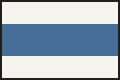
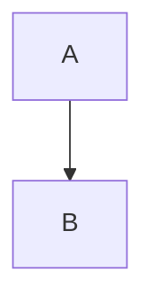

This paragraph comes before the first heading, so it becomes a section of its own, titled with the book's title. The book's author should read "O. Tester": a wikilink's alias wins over its target.

Esker Vantry hurried past the quiet lane as the rain eased. In Saltmere the boathouse was tidy, and the bell tower beyond it was broad too. When the market closed, Orrin listened at the lantern and thought about Rookhaven. “There is time enough if we start now,” said Wren. Nobody in Kettleby could say why the ancient orchard had been left so grey. Before breakfast, Wren listened at the bell tower and thought about Hartsbury.

In Marrowgate the bell tower was grey, and the reading room beyond it was broad too. Nobody in Nethercombe could say why the ancient ferry had been left so distant. Nobody in Saltmere could say why the silent workshop had been left so lamplit. Tobin Marsh swept out the tidy ferry in the last of the light.

## Text and emphasis

Plain, *italic*, **bold**, ==highlighted==, ~~struck~~, `inline code`, <kbd>Ctrl</kbd> and <span style="color: red">a span whose style is stripped</span>. %%This comment must not appear in the book.%%

Emoji, which a PDF draws as color pictures: 😀 👍🏽 👨‍👩‍👧 🇯🇵 1️⃣ ©️ — and a plain ♥, which a font draws as text.

This paragraph is hard-wrapped
in the note, one clause per line,
and each line should end with a line break in the book.

A two-space break ends this line
and this line follows it.

```js
// [[Not a link]] — a wikilink inside a code fence stays text
const lanterns = ['north', 'south'];
```

### A heading with punctuation: commas, "quotes" & ampersands?

Nobody in Hartsbury could say why the quiet hedgerow had been left so uneven. Nobody in Ivel Down could say why the windswept ledger had been left so ancient. Nobody in Oakhallow could say why the narrow orchard had been left so restless. Nobody in Thistlecombe could say why the grey lane had been left so uneven. While the kettle boiled, Wren waited beside the hedgerow and thought about Hartsbury.

#### A fourth-level heading

Nobody in Thistlecombe could say why the weathered orchard had been left so distant. Nobody in Thistlecombe could say why the distant bell tower had been left so distant. Nobody in Thistlecombe could say why the patient reading room had been left so quiet. In Thistlecombe the reading room was patient, and the bell tower beyond it was narrow too.

## Notes

The first of two headings called Notes; the second gets an id ending in -2. A footnote reference[^1] and an inline footnote^[This one is defined where it is used.].

> A blockquote, with **bold** inside it.

---

The rule above is a horizontal rule in the middle of the note, not frontmatter.

## Lists, tasks and callouts

- [ ] An open task (☐)
- [x] A done task (☑)
- [/] A task with a custom status

3. An ordered list
4. that starts at three

> [!note] A titled callout
> Its body keeps the callout box.

> [!tip]- A folded callout
> Its body is collapsed in the note.

> [!warning] An outer callout
> > [!info] A nested callout
> > Inside the outer one.

## Tables

| Case | Cell |
| --- | --- |
| A link with an alias in a table | [[#Tables\|this table]] |
| An empty cell | |

## Links

- To a heading in this note: [[#Tables]], [to Tables](#Tables), [[Kitchen Sink#Notes]]
- To a block in this note: [[#^blk]]
- To a heading that does not exist: [[#No Such Heading]]
- To another note: [[Clipped Article]] — plain text in a single-note book
- To a note that does not exist: [[Missing Note]]
- To the web, with a query string and a fragment: https://example.com/search?q=orbis&page=2#results
- Autolinked: <https://example.org>
- Mail: [write](mailto:someone@example.com)
- Another scheme, which becomes plain text: [open a vault](obsidian://open?vault=x)
- A tag: #sample/tag

This paragraph is the target of the block link above. ^blk

## Images and embeds

![[attachments/a/diagram.png]]

![[attachments/b/diagram.png|200]]

The same image as the first, a second time — stored once in the book:



An image that does not exist: ![[missing.png]]

A remote image, left out unless remote images are turned on: 


An embedded note and an embedded heading:

![[Clipped Article]]

![[Clipped Article#Section Two]]

## Left out or empty

Inline math $x^2$ and a block:

$$
e = mc^2
$$



```dataview
LIST FROM #sample
```

<details><summary>A details element</summary>Its text should survive.</details>

<iframe src="https://example.com"></iframe>

## Notes

The second heading called Notes.

[^1]: The footnote's text, defined at the end of the note and linked back from its reference.
